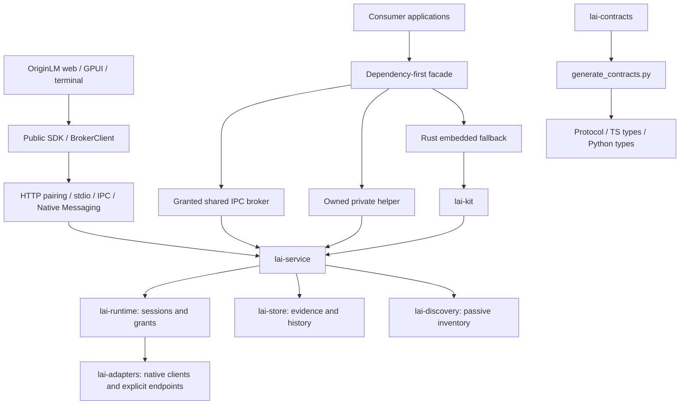

# OriginLM v1 principal review

Status: **in progress**, 2026-10-28. This is an integration review, not a release
qualification. Findings remain open until a concrete change and verification
result are recorded. No live account use is authorized by this review.

## Architecture map

Rust owns provider behavior and permissions. Consumers must not infer grants
from discovery or turn missing quota evidence into zero. The control plane is
local; explicitly authorized provider operations can contact remote providers.
“Nothing leaves the machine” is therefore not a valid blanket inference claim.

## Integration baseline

- Main baseline: `9079e50`.
- Distribution stack: `41af8dd` (`feat/service-install`).
- Landing branches merged with Hallmark's structure and original scene pointer
  interactions. Visual reconciliation is still pending.
- Master draft: https://github.com/thomaslittle/local-ai-kit/pull/55.

## Findings and disposition

| ID | Priority | Finding | Fix / evidence |
|---|---|---|---|
| V1-001 | P1 | Private helper startup failure can leak owned children in TS, Python and Rust; timeout/error paths do not all reap processes. | Open: unify cleanup across startup and close, add synthetic lifecycle regressions. |
| V1-002 | P1 | Dependency-first shared connection and protocol fallback do not yet implement ADR-002 D9 consistently. | Open: trace authentication versus incompatibility and preserve fail-closed grants. |
| V1-003 | P1 | GitHub reports active dependency advisories for undici, rustls, setuptools, fast-uri and lru. | Open: inspect affected locked paths and upstream patches; qualify bounded upgrades. |
| V1-004 | P2 | ADR-002 privacy statement says nothing leaves the machine despite explicit remote provider operations. | Open: clarify local control plane versus authorized provider traffic across public copy. |
| V1-005 | P2 | Rust helper resolution silently ignores an invalid environment override; TS and Python reject it. | Open: align explicit override failure semantics. |
| V1-006 | P2 | The integration has three independently maintained visual token systems. | Open: establish one brand source with generated consumer outputs. |

This initial list is not an exhaustive audit. No P0 finding has been established;
that is not a certification that none exists. Further findings are added while
reviewing each crate, package, workflow and product surface.

## Verification ledger

- **Planned:** whole-product review, remediation, visual work, film, full check pass.
- **Implemented:** upstream integration only.
- **Fixture-tested:** no new results yet.
- **Platform-executed:** Git integration on Linux only; no product execution yet.
- **Live-qualified:** none; no inference or account probing performed.

## Final acceptance

Final checks are deferred until the implementation pass, per the review brief.
Record exact commands, source SHA, platform, failures and limitations here.
Do not inherit test claims from a different commit or call unexecuted OSes green.
