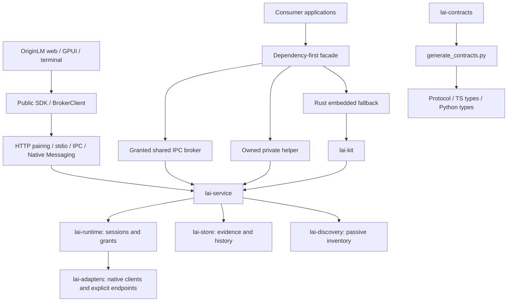

# OriginLM v1 principal review

Status: **in progress**, 2026-10-28. This is an integration review, not a release
qualification. Findings remain open until a concrete change and verification
result are recorded. No live account use is authorized by this review.

## Architecture map

Rust owns provider behavior and permissions. Consumers must not infer grants
from discovery or turn missing quota evidence into zero. The control plane is
local; explicitly authorized provider operations can contact remote providers.
“Nothing leaves the machine” is therefore not a valid blanket inference claim.

## Integration baseline

- Main baseline: `9079e50`.
- Distribution stack: `41af8dd` (`feat/service-install`).
- Landing branches merged with Hallmark's structure and original scene pointer
  interactions. Visual reconciliation is still pending.
- Master draft: https://github.com/thomaslittle/local-ai-kit/pull/55.

## Findings and disposition

| ID | Priority | Finding | Fix / evidence |
|---|---|---|---|
| V1-001 | P1 | Private helper startup failure can leak owned children in TS, Python and Rust; timeout/error paths do not all reap processes. | Implemented: owned-process guard in Rust and cleanup spanning startup/bridge errors in TS/Python, including Python cancellation. Synthetic regressions added; execution deferred to final phase. |
| V1-002 | P1 | Dependency-first shared connection and protocol fallback do not yet implement ADR-002 D9 consistently. | Open: trace authentication versus incompatibility and preserve fail-closed grants. |
| V1-003 | P1 | GitHub reports active dependency advisories for undici, rustls, setuptools, fast-uri and lru. | Open: inspect affected locked paths and upstream patches; qualify bounded upgrades. |
| V1-004 | P2 | ADR-002 privacy statement says nothing leaves the machine despite explicit remote provider operations. | Implemented: ADR-003, root privacy statement, ADR-002 correction and site copy distinguish local state from authorized remote provider traffic. |
| V1-005 | P2 | Rust helper resolution silently ignores an invalid environment override; TS and Python reject it. | Implemented: Rust start rejects invalid configured overrides before attempting shared or embedded fallback. Regression added; execution pending. |
| V1-006 | P2 | The integration has three independently maintained visual token systems. | Open: establish one brand source with generated consumer outputs. |

| V1-007 | P1 | Default Unix uninstall deletes workspaces despite its keep-data promise; Windows unregisters without stopping its task. | Implemented: preserve workspaces unless purging; stop Windows task before removing it. Execution pending. |
| V1-008 | P2 | Service file argument splitting breaks paths with spaces/XML characters; fallback socket differs from SDK discovery. | Implemented: serialize launchd arguments individually, quote systemd values, align fallback socket. Throwaway-prefix verification pending. |
| V1-009 | P1 | Release packaging consumes unsigned artifacts; published archive names do not match installer expectations; Windows binary paths omit `.exe`. | Open: reconcile packaging and signing gates before release qualification. |

This initial list is not an exhaustive audit. No P0 finding has been established;
that is not a certification that none exists. Further findings are added while
reviewing each crate, package, workflow and product surface.

## Verification ledger

- **Planned:** whole-product review, remediation, visual work, film, full check pass.
- **Implemented:** upstream integration and private-helper lifecycle cleanup; invalid Rust override rejection.
- **Fixture-tested:** no new results yet.
- **Platform-executed:** Git integration on Linux only; no product execution yet.
- **Live-qualified:** none; no inference or account probing performed.

## Final acceptance

Final checks are deferred until the implementation pass, per the review brief.
Record exact commands, source SHA, platform, failures and limitations here.
Do not inherit test claims from a different commit or call unexecuted OSes green.

## Continued review findings

| ID | Priority | Finding | Fix / evidence |
|---|---|---|---|
| V1-010 | P1 | Control/desktop Rust IPC client ignored authentication and handshake results, allocated unbounded response lines, and renewed its timeout for every unrelated notification. | Implemented explicit authentication/version checks, 1 MiB response bound and one deadline across request write/read. Failed streams are discarded. Malicious fixture regressions added; execution pending. |
| V1-011 | P2 | Desktop counted stale authentication as current; web reported zero open issues without issue evidence. | Implemented fresh-only authentication count, cached stale label, unknown issue count and explicit disconnected example-mode footer. Visual recheck pending. |

Implementation updates: V1-003 has bounded patched dependencies recorded in
`docs/dependency-audit-2026-10-28.md`; final qualification remains pending.
V1-006 has a shared core color/font source in `brand/tokens.json` with generated
CSS and GPUI outputs; remaining surface-specific tokens are still under review.
Linux native and web/site production builds have run successfully before the
latest changes. Headless synthetic screenshots exist; they do not qualify live
accounts, other operating systems, or all product flows.

V1-002 update: all three automatic resolvers now distinguish protocol mismatch
from grant denial. TS/Python negotiate while choosing the shared transport, close
an incompatible connection, and start their private helper; denied grants remain
fatal. Python only falls back for explicitly classified unavailable transports,
not arbitrary domain errors, and excludes private-only options from shared
connection arguments. Structured mismatch status reporting remains pending.

V1-012 (P1): the Rust embedded fallback started Tokio background tasks before
constructing/entering its runtime. Runtime construction and entry now precede
kit initialization and background-task startup. Final fixture execution pending.
