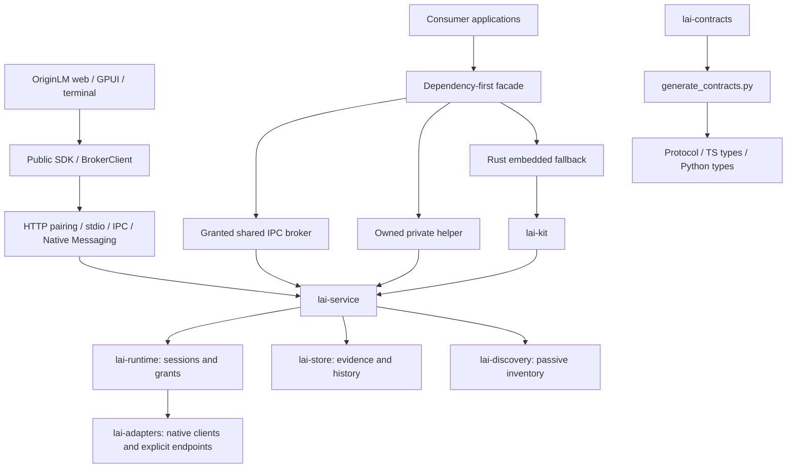

# OriginLM v1 principal review

Status: **local qualification and all nine hosted checks pass at `b089433`**, 2026-10-28.
The current [ship-readiness report](V1-SHIP-READINESS.md) and
[verification record](V1-VERIFICATION.json) supersede investigation-time
“pending” notes below. This is a source-preview integration review, not public
release or live-provider qualification. No live account use is authorized.

## Architecture map

Rust owns provider behavior and permissions. Consumers must not infer grants
from discovery or turn missing quota evidence into zero. The control plane is
local; explicitly authorized provider operations can contact remote providers.
“Nothing leaves the machine” is therefore not a valid blanket inference claim.

## Integration baseline

- Main baseline: `9079e50`.
- Distribution stack integrated through `feat/web-bridge` (`cf3a0b6` / `a2e0ef1`), including status-tray `865dfb3`.
- Landing branches merged with Hallmark's structure and original scene pointer
  interactions. v1 now owns site/video; no further landing-site merges are permitted.
- Master draft: https://github.com/thomaslittle/local-ai-kit/pull/55.

## Findings and disposition

| ID | Priority | Finding | Fix / evidence |
|---|---|---|---|
| V1-001 | P1 | Private helper startup failure can leak owned children in TS, Python and Rust; timeout/error paths do not all reap processes. | Implemented: owned-process guard in Rust and cleanup spanning startup/bridge errors in TS/Python, including Python cancellation. Synthetic regressions added; execution deferred to final phase. |
| V1-002 | P1 | Dependency-first shared connection and protocol fallback do not yet implement ADR-002 D9 consistently. | Implemented protocol mismatch fallback with grant denial kept fatal; structured fallback reason is now exposed. Verification pending. |
| V1-003 | P1 | GitHub reports active dependency advisories for undici, rustls, setuptools, fast-uri and lru. | Patched bounded dependencies; see 2026-10-28 dependency audit. Final qualification pending. |
| V1-004 | P2 | ADR-002 privacy statement says nothing leaves the machine despite explicit remote provider operations. | Implemented: ADR-003, root privacy statement, ADR-002 correction and site copy distinguish local state from authorized remote provider traffic. |
| V1-005 | P2 | Rust helper resolution silently ignores an invalid environment override; TS and Python reject it. | Implemented: Rust start rejects invalid configured overrides before attempting shared or embedded fallback. Regression added; execution pending. |
| V1-006 | P2 | The integration has three independently maintained visual token systems. | Implemented brand/tokens.json and generated web/native/site/film values. Final visual lint pending. |

| V1-007 | P1 | Default Unix uninstall deletes workspaces despite its keep-data promise; Windows unregisters without stopping its task. | Implemented: preserve workspaces unless purging; stop Windows task before removing it. Execution pending. |
| V1-008 | P2 | Service file argument splitting breaks paths with spaces/XML characters; fallback socket differs from SDK discovery. | Implemented: serialize launchd arguments individually, quote systemd values, align fallback socket. Throwaway-prefix verification pending. |
| V1-009 | P1 | Release packaging consumes unsigned artifacts; published archive names do not match installer expectations; Windows binary paths omit `.exe`. | Implemented preparation-only workflow and matching archives, conservative wheel tags and private preview packs (ADR-007). Signing/publication not claimed. |

This initial list is not an exhaustive audit. No P0 finding has been established;
that is not a certification that none exists. Further findings are added while
reviewing each crate, package, workflow and product surface.

## Verification ledger

- **Planned:** whole-product review, remediation, visual work, film, full check pass.
- **Implemented:** integration, lifecycle/security fixes, cost evidence and editable prices, dashboard/native improvements, shared 3D scene and 35-second film source.
- **Fixture-tested:** no new results yet.
- **Platform-executed:** Linux web/site/native builds, headless example-mode captures, 1080p film render. Full suites and other OS execution still pending.
- **Live-qualified:** none; no inference or account probing performed.

## Final acceptance

Final checks are deferred until the implementation pass, per the review brief.
Record exact commands, source SHA, platform, failures and limitations here.
Do not inherit test claims from a different commit or call unexecuted OSes green.

## Continued review findings

| ID | Priority | Finding | Fix / evidence |
|---|---|---|---|
| V1-010 | P1 | Control/desktop Rust IPC client ignored authentication and handshake results, allocated unbounded response lines, and renewed its timeout for every unrelated notification. | Implemented explicit authentication/version checks, 1 MiB response bound and one deadline across request write/read. Failed streams are discarded. Malicious fixture regressions added; execution pending. |
| V1-011 | P2 | Desktop counted stale authentication as current; web reported zero open issues without issue evidence. | Implemented fresh-only authentication count, cached stale label, unknown issue count and explicit disconnected example-mode footer. Visual recheck pending. |

Implementation updates: V1-003 has bounded patched dependencies recorded in
`docs/dependency-audit-2026-10-28.md`; final qualification remains pending.
V1-006 has a shared core color/font source in `brand/tokens.json` with generated
CSS and GPUI outputs; remaining surface-specific tokens are still under review.
Linux native and web/site production builds have run successfully before the
latest changes. Headless synthetic screenshots exist; they do not qualify live
accounts, other operating systems, or all product flows.

V1-002 update: all three automatic resolvers now distinguish protocol mismatch
from grant denial. TS/Python negotiate while choosing the shared transport, close
an incompatible connection, and start their private helper; denied grants remain
fatal. Python only falls back for explicitly classified unavailable transports,
not arbitrary domain errors, and excludes private-only options from shared
connection arguments. Automatic clients now expose FALLBACK_PROTOCOL_MISMATCH in TS fallbackReason, Python fallback_reason and Rust fallback_reason()/status. Execution remains pending.

V1-012 (P1): the Rust embedded fallback started Tokio background tasks before
constructing/entering its runtime. Runtime construction and entry now precede
kit initialization and background-task startup. Final fixture execution pending.

V1-013 (P1): incoming web detection accepted any opaque HTTP response and called
availability “connected”. Implemented same-window/origin message filtering,
loopback-only requests, no credentials/redirects, bounded runtime-info validation
and separate authorized badge state. Added security fixtures and included the
new package in workspace build/verification. Corrected unimplemented website
pairing/PNA/content-script claims rather than weakening the host's origin boundary.

V1-014 (P2): helper/facade/GPUI pulled terminal dependencies through shared control
code. Made terminal dependencies optional and disabled them for nonterminal
consumers (ADR-004). Isolated artifact size comparison pending.

Integration update: merged `feat/web-bridge` (including status/mini-view) and
`feat/landing-site` through `dbcbb1c`. Incoming video source/render claims are
under review; they are not yet adopted as v1-qualified outputs.

### V1-015 — Cost trends had no evidence contract (P1)

Implemented native cost contracts, bounded owner-scoped runtime observations, exact decimal estimation, admin-only local price editing, source/date defaults, and an explicit unavailable basis. OpenRouter charges are accepted only from its documented HTTPS origins. Web overview/usage and Settings now consume the public SDK. See ADR-005 for scope and limits. Rust service/adapter and web builds executed; regression tests authored but not yet run. Native UI integration and final verification pending.

### V1-016 — Motion assets contradicted the requested physical UI direction (P1)

Replaced the seven translucent layers and packet dots with one deterministic five-layer three.js scene. The site, offline film capture and generated poster now share the camera/material implementation. Real example-mode UI textures include quota rings, reset countdowns, cost evidence, SDK code, public methods and grants. Removed React Three Fiber, Drei and the separate postprocessing dependency; the new lazy scene build is approximately 145 KB gzip. Added a CSS-perspective UI stack below the hero. Film recut to 35 seconds is in progress; no final visual/performance qualification claimed.

### V1-017 — Desktop polling fabricated fresh history and grew storage without a disk bound (P1)

History compared each window to the final record of any window, so repeated multi-pool polls appended unchanged data. It also assigned the poll timestamp to stale observations. Now comparison is per pool/window, only fresh evidence is recorded, and timestamps come from the observation. Persistence atomically rewrites the bounded 6,000-record set with Unix mode 0600; loading is byte-bounded. Added regression tests (not yet executed). Moved platform state-directory resolution into lai-platform and reused it from the kit and desktop; a missing home/state directory now disables persistence rather than writing into the working directory.

Native cost view and Settings price editor now consume costs.read/setPrices. Linux native build executed before the final history regression additions; final checks remain pending. Fixed the broker worker to exit when its command channel closes while offline. Mini-view unknown values and stale reset copy are corrected; no OS tray is claimed.

### Execution rulings

- The owner's explicit phase-F verification order takes precedence over generic per-task test gates. Builds and visual iterations are recorded separately from tests; no authored regression is claimed as passing before execution.
- Keep this existing repository review ledger as the integration record rather than starting a parallel status document mid-review. The detailed user brief and ADRs remain the scope authority.
- One maintained motion renderer replaces separate site and film scene implementations. The film's interactive preview player and unused 3D dependencies are removed; headless rendering is the supported workflow here.

### V009 implementation update: release preparation

Replaced the nonfunctional publish-on-tag pipeline with native five-target artifact
preparation (ADR-007). Correct archive names/Windows suffix, exact size budget, built
SDK, explicitly private preview packs, py3-none wheel ABI, conservative platform tags,
source/checksum manifest and no unused signing output. Public signing/publication is
not implemented or claimed. Windows installer now selects one exact bounded ZIP member,
requires one exact checksum entry, and honors an optional pinned Authenticode signer
without downgrade. Unsupported Windows ARM64 fails explicitly. Phase F checks pending.

### V015 follow-up: small provider charges

Normalize bounded scientific-notation JSON cost numbers into canonical plain decimal
strings. Previously a real charge such as 1e-7 silently became unknown. Negative and
oversized expansions remain rejected. Regression cases authored; execution deferred
to Phase F with the rest of the checks.

### V1-018 (P1): bounded, race-resistant grant descriptor reads

Rust facade/control, TypeScript and Python validated a pathname then read the file
again without a hard read bound. Python also assumed the JSON root was an object.
Rust now shares `lai-platform::read_private_file`; SDK readers check the opened
regular file, owner-only Unix permissions, identity and size, read at most 16 KiB
plus one byte, and close handles on every path. Unix opens reject links and avoid
blocking on swapped FIFOs. Windows checks regular-file identity/reparse semantics;
ACL ownership is not claimed. Helper resolution also checks Unix execute permission
and never ignores an invalid Rust environment override. Regression cases authored;
Native Settings now uses the same bounded descriptor reader; it no longer reads an arbitrary-size credential file during rendering. Phase F execution pending.

### V1-019 (P2): documentation and marketing drift

Replaced invalid site sample APIs/host IDs, unstated registry prerequisites, the
machine-specific native token path and hosted installer placeholders. Added current
architecture, source/local-package quickstarts, user dashboard guide, troubleshooting,
privacy and explicit extension/pairing limits. Native Snapshot/error types are exported
from the dependency-first facade so consumers do not need a second contract dependency.
Python preview version aligns with alpha.20. All snippets remain pending Phase F execution;
Tauri/Electron/GPUI integration fragments are labeled as integrations into existing apps. Removed unsupported competitor generalizations, universal provider coverage and an unimplemented generated-privacy claim. Grant-request examples now explicitly identify the host-approval response.

### V1-020 (P2): status conflated connection failure with denied grants

CLI status now distinguishes an explicit authorization denial (exit 4) from malformed
descriptors, incompatible protocols and transport failures (exit 1, authorization unknown).
BrokerClient's connect itself has a two-second bound in addition to its request deadline.
Automatic clients expose an explicit protocol-mismatch fallback reason. No grant denial
is downgraded into a private fallback. Existing synthetic regressions extended; unrun.

### V1-021 (P1): a domain denial poisoned the control connection

The earlier transport cleanup discarded a stream after any RPC error, including a
fully parsed permission denial. A non-admin control client requesting apps.list then
lost access to later permitted reads. Only incomplete/invalid transport exchanges now
invalidate the stream. `BrokerClient::call_typed` preserves canonical codes and bounded
retry hints while suppressing untrusted error bodies; the Rust facade uses it directly.
A denial-then-snapshot fixture and retry-hint/redaction fixture are authored; execution
pending. Price-file loading also uses the common bounded opened-file reader.

### V1-022 (P2): native privilege labels trusted the descriptor filename

The desktop called a credential “administrator” when its filename contained `admin`.
Removed filename-derived privilege state. Administration is now shown as confirmed
only after a successful runtime `apps.list` response without a connection error;
example/offline/denied states never claim administrator access. Removed the implicit
`./admin-token.json` fallback when no configured/home descriptor exists. The native
build passed for privilege labels; the fallback change awaits the final pass.

### V1-023 (P1): public nested methods and inventory subscriptions fail at transport boundaries

TS HTTP, Node, Native Messaging and Python validated exactly two method-name
segments, rejecting advertised `auth.chatgpt.*` RPCs. HTTP also omitted the inventory
scope on the client and rejected it on the server, so inventory subscriptions could
read the wrong event stream. Implemented: shared TS method validation permits
bounded dotted identifiers; Python matches it; HTTP validates and forwards the
inventory scope and rejects mixed inventory/session queries. Inventory replay cursors
retain their opaque epoch/sequence form; session cursors remain bounded integers.
An initial HTTP 409 replay gap is translated to `EVENT_GAP` so the live store can
resynchronize rather than repeatedly retrying the expired cursor. Pairing-code requests now
honor cancellation and a bounded deadline as RPCs already did. Regression fixtures
are authored; SDK/transport builds passed before the final pairing deadline change.
The full verification pass remains pending.

### V1-024 (P1): live store could spin and omit its replay cursor

Paginated catalog reads omitted cursor, health and issue evidence. The live store
could immediately resubscribe after clean EOF/repeated gaps, and an old cleanup
closure could abort a newer connection. Implemented: preserve all snapshot
header fields, back off replay/reconnect attempts, bind cleanup to its own controller
and clear pending coalesced reads on disconnect. The SDK build passes; regression
fixtures are authored and await the final verification pass.

### V1-025 (P1): resetting sensitive options bypassed host approval

The React option editor asked the host before setting a billing/permission-sensitive
value but skipped approval when removing the override. Provider defaults can change
billing or permission too. Apply the same host approval to reset-to-default; preserve
late-response selection checks. Regression fixture authored; execution pending.

### V1-026 (P2): control-center decoration and touch copy controls

Removed moving background glows, nested outer section cards, unused Outfit loading
and unused decorative CSS. Sections now use semantic headings and rules; copy
buttons remain visible with 44px targets and report clipboard failure. Tiny USD
amounts use scientific notation instead of rounding a nonzero cost to zero. Demo
build passed before the last copy/formatting refinement; visual qualification is
pending. Screens and film captures will be refreshed from the finished example UI.

### V1-027 (P2): native price editing used a stale row index

The native editor could overwrite a different row after a price-table refresh.
It now retains the original record and rejects editing/removal if that record
changed. Added removal with the fields retained for restoration through Save.
This prevents stale-row edits locally; simultaneous administrative replacements
remain last-write-wins at the protocol level and are not claimed transactional.
Native build passed; fixture verification pending.

### V1-028 (P1): updater compared prerelease versions lexicographically

The updater treated `alpha.9` as newer than `alpha.20`, reversing valid upgrade and
downgrade decisions. Its permissive suffix parser also accepted path characters
in the version used for staging directories. Replace it with the already-locked
semver parser/precedence comparator, and require the supported numeric alpha family.
Signed synthetic update regressions cover digit boundaries and invalid suffixes.
Implemented; focused build passed. Signed fixture execution remains pending.

### V1-029 (P1): updater activation did not install the signed bytes

Activation verified the single-executable archive but copied a separate unsigned
`staged/local-ai-kit` file, and bypassed downgrade rejection. The documented update
format already is one executable, so remove that second-file seam: copy the verified
archive into a fresh target-side temporary file, verify those exact bytes again,
then replace. Preserve executable permissions and retain the active-session lease.
Signed fixtures now assert that an unrelated staged executable cannot be installed.
Staging uses exclusive directory/file creation and cleans failed partial copies;
manifest/marker reads and hash loops are bounded. Already archived crash markers
are no longer repeatedly renamed. Focused builds pass; fixture execution is pending.

### V1-030 (P1): fresh review — Python broker environment and price serialization

The fresh reviewer identified that Python auto startup applied caller env/cwd only
to its bridge, not the private broker that performs discovery. It also raised
a possible writer/reader size mismatch. The final test established that the existing
64 KiB request limit already rejects such a table before saving; the additional
128 KiB serialized-write guard preserves the reader boundary if request limits evolve. Implemented one validated process environment
for both Python children, and serialization-size validation before changing prices.
Regressions authored; final execution pending.

### V1-031 (P1): Node shared startup and Rust preflight boundaries

Both Node broker startup paths inherited the whole environment, while the bridge
filtered it. All three now share one validated process policy. Both descriptor
readers share the bounded, no-follow, owner-private reader. The explicit shared
starter propagates authentication/protocol failures and cleans up its own child
on startup failure. Rust's preliminary IPC reachability probe now has the same
two-second deadline as its client connection. Regressions authored; execution pending.

### V1-032 (P1): update downgrade floor was the host's compile-time version

A long-lived alpha.20 host could install alpha.22 and subsequently accept alpha.21.
Activation now reads persisted versions under its lock, records the highest verified
version durably before replacement, and refuses malformed state. Explicit rollback
retains the floor. ADR-008 describes the conservative crash behavior. Signed
sequential-activation and corrupt-state regressions authored; execution pending.

### V1-033 (P1): live-store disposal recursively called its own override

The final lifecycle regressions exposed that `Object.assign(store, …)` replaced
`store.dispose`, and the extension then called itself. Capture the base disposer
before extending the object. Both lifecycle regressions now pass.

### V1-034 (P2): obsolete site CSS and inherited primitive motion defaults

The first design sweep found an unimported legacy stylesheet, broad transitions
and animated layout dimensions inherited from UI primitives, plus duplicate dark
palette literals. Removed the unused file, narrowed motion to named properties,
and reused brand tokens. Rendered sweep and accessibility qualification in progress.

### V1-035 (P1): long Unix temporary paths broke dependency-first startup

The fresh packed Node consumer failed to start its real helper under a 117-byte
socket path. Unix `sun_path` limits are smaller than normal filesystem paths.
Node, Python and Rust now use a short `/tmp` endpoint when their normal temporary
path exceeds 100 bytes; owner-only socket permissions and per-connection auth remain.
The same long-home artifact consumers are the regression evidence. No inference.

### V1-036 (P2): final responsive and accessibility qualification

The rendered sweep found weak form boundaries, a collapsed mini-view image caused
by generic placeholder CSS, and a narrow usage grid. Corrected the shared input
contrast, restored the real image's intrinsic layout, made the usage grid shrink,
and gave the sidebar trigger a 44px target. The selector test host now explicitly
opens its intended route after Overview became the product default. No design
finding is suppressed by replacing a required check.

### V1-037 (P2): hero separation was mostly time-driven

Scrolling now owns the full collapsed-to-exploded range, spring-damped in both
directions. The camera intro is independent. A headless software-WebGL regression
checks separation and reversal; reduced-motion and no-script cases retain the
static scene and native layer disclosure. Both web apps share a 40,820-byte WOFF2
asset converted losslessly from the licensed variable font, reducing the mobile
critical path without changing glyphs or axes. Hardware frame-rate claims remain
unqualified. Video work stopped at Thomas's direction; existing outputs are retained.

### V1-038 (P2): independent finish review

The first finish pass requested settled captures; waiting for lazy chart resolution
and CSS-mask SVG decode corrected both capture artifacts. The scored pass then
identified four changes: enlarge/lower the collapsed hero, repeat static layer names
as readable HTML, show the native cost range and observation order, and replace a
generic integration heading with the actual import/protocol promise. Implemented
all four. Site framing is opt-in to the hero; existing media outputs are unchanged.
Native chart geometry uses finite f64 display values while money remains exact in
the contract. The independent scoring check confirms all four resolved, none partial or open.
Builds and focused checks pass.

### V1-039 (P2): CI used moving runner labels and macOS never acquired a runner

GitHub cancelled the macOS ARM-labelled job before any step ran, reporting hosted
runner capacity constraints. Pin the full matrix to supported Ubuntu 24.04,
Windows 2025 and macOS 15 Intel images; retain both Mac architectures in artifact
preparation. The dependency audit records the official catalog and failed-job link.
This is an environment correction, not a fabricated test pass.

### V1-040 (P2): uninstall and helper environments drifted from native paths

The service removers still targeted the legacy native-host filename and missed
XDG/macOS runtime data directories; Windows also registers the current host in
HKCU. Removal now uses the canonical host name, configured XDG roots, macOS
Application Support, and Windows runtime data override. Ordinary removal preserves
data; explicit purge rejects a root/home alias before deleting anything. Windows
removal has a filesystem fixture that stubs task/registry/other external operations.
Node/Python children now preserve standard OS state/config variables as well as
the toolkit's explicit state override. Four Unix removal regressions pass (the
canonical-name cases failed before the fix), all 88 TS SDK tests and 40 Python
tests pass; the Windows fixture awaits its actual Windows CI execution.

### V1-041 (P2): the app shell nested a main landmark

The generated SidebarInset already renders `main`; its inner page wrapper also
used `main`. Keep the primitive's landmark and use a neutral inner layout wrapper.
The existing route accessibility checks now assert that no nested main exists.
This changes semantics without changing layout or introducing another primitive.

### V1-042 (P1): Electron ASAR packages could not start their unpacked helper

A real headless Electron ASAR consumer reproduced `spawn ENOTDIR`: filesystem
checks accepted a virtual archive path even though native spawn cannot use it.
The Node SDK now selects the physical `.asar.unpacked` helper in Electron and
reports `HELPER_NOT_UNPACKED` when the packager omitted it. Ordinary Node resolution
is unchanged. All helper launch sites normalize synchronous OS exceptions; invalid
NUL-containing executable paths fail with a safe typed error. Both regressions
failed before the fix; all 90 SDK tests pass. The final qualification record covers
the packed-artifact Electron run separately from fixtures and other platforms.

Hosted follow-up: macOS executes the SDK fixture through Node's canonical
`/private/var` path. The ASAR resolution assertion now compares the physical
unpacked file's canonical path, retaining the exact-tree check and missing-file
rejection. This corrects fixture portability; no runtime behavior changed.

### V1-043 (P2): CI's cold macOS build exceeded its job deadline

At `34696c3`, macOS passed full deterministic verification, the C# consumer,
formatting and clippy. GitHub then cancelled release-artifact compilation at the
40-minute job deadline; its annotation explicitly reports the maximum execution
time. The full job now has a bounded 75-minute budget for debug/test, lint and
release compilation. All checks remain required. Linux and Windows full jobs
passed at this checkpoint; the complete macOS rerun passed at `b089433`.
Evidence: [cancelled macOS job](https://github.com/thomaslittle/local-ai-kit/actions/runs/40698238160/job/122850744391).
