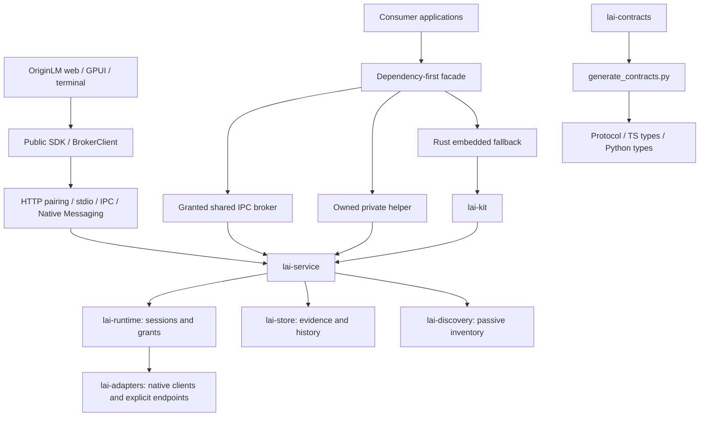

# OriginLM v1 principal review

Status: **in progress**, 2026-10-28. This is an integration review, not a release
qualification. Findings remain open until a concrete change and verification
result are recorded. No live account use is authorized by this review.

## Architecture map

Rust owns provider behavior and permissions. Consumers must not infer grants
from discovery or turn missing quota evidence into zero. The control plane is
local; explicitly authorized provider operations can contact remote providers.
“Nothing leaves the machine” is therefore not a valid blanket inference claim.

## Integration baseline

- Main baseline: `9079e50`.
- Distribution stack integrated through `feat/web-bridge` (`cf3a0b6` / `a2e0ef1`), including status-tray `865dfb3`.
- Landing branches merged with Hallmark's structure and original scene pointer
  interactions. v1 now owns site/video; no further landing-site merges are permitted.
- Master draft: https://github.com/thomaslittle/local-ai-kit/pull/55.

## Findings and disposition

| ID | Priority | Finding | Fix / evidence |
|---|---|---|---|
| V1-001 | P1 | Private helper startup failure can leak owned children in TS, Python and Rust; timeout/error paths do not all reap processes. | Implemented: owned-process guard in Rust and cleanup spanning startup/bridge errors in TS/Python, including Python cancellation. Synthetic regressions added; execution deferred to final phase. |
| V1-002 | P1 | Dependency-first shared connection and protocol fallback do not yet implement ADR-002 D9 consistently. | Implemented protocol mismatch fallback with grant denial kept fatal; structured fallback reason is now exposed. Verification pending. |
| V1-003 | P1 | GitHub reports active dependency advisories for undici, rustls, setuptools, fast-uri and lru. | Patched bounded dependencies; see 2026-10-28 dependency audit. Final qualification pending. |
| V1-004 | P2 | ADR-002 privacy statement says nothing leaves the machine despite explicit remote provider operations. | Implemented: ADR-003, root privacy statement, ADR-002 correction and site copy distinguish local state from authorized remote provider traffic. |
| V1-005 | P2 | Rust helper resolution silently ignores an invalid environment override; TS and Python reject it. | Implemented: Rust start rejects invalid configured overrides before attempting shared or embedded fallback. Regression added; execution pending. |
| V1-006 | P2 | The integration has three independently maintained visual token systems. | Implemented brand/tokens.json and generated web/native/site/film values. Final visual lint pending. |

| V1-007 | P1 | Default Unix uninstall deletes workspaces despite its keep-data promise; Windows unregisters without stopping its task. | Implemented: preserve workspaces unless purging; stop Windows task before removing it. Execution pending. |
| V1-008 | P2 | Service file argument splitting breaks paths with spaces/XML characters; fallback socket differs from SDK discovery. | Implemented: serialize launchd arguments individually, quote systemd values, align fallback socket. Throwaway-prefix verification pending. |
| V1-009 | P1 | Release packaging consumes unsigned artifacts; published archive names do not match installer expectations; Windows binary paths omit `.exe`. | Implemented preparation-only workflow and matching archives, conservative wheel tags and private preview packs (ADR-007). Signing/publication not claimed. |

This initial list is not an exhaustive audit. No P0 finding has been established;
that is not a certification that none exists. Further findings are added while
reviewing each crate, package, workflow and product surface.

## Verification ledger

- **Planned:** whole-product review, remediation, visual work, film, full check pass.
- **Implemented:** integration, lifecycle/security fixes, cost evidence and editable prices, dashboard/native improvements, shared 3D scene and 35-second film source.
- **Fixture-tested:** no new results yet.
- **Platform-executed:** Linux web/site/native builds, headless example-mode captures, 1080p film render. Full suites and other OS execution still pending.
- **Live-qualified:** none; no inference or account probing performed.

## Final acceptance

Final checks are deferred until the implementation pass, per the review brief.
Record exact commands, source SHA, platform, failures and limitations here.
Do not inherit test claims from a different commit or call unexecuted OSes green.

## Continued review findings

| ID | Priority | Finding | Fix / evidence |
|---|---|---|---|
| V1-010 | P1 | Control/desktop Rust IPC client ignored authentication and handshake results, allocated unbounded response lines, and renewed its timeout for every unrelated notification. | Implemented explicit authentication/version checks, 1 MiB response bound and one deadline across request write/read. Failed streams are discarded. Malicious fixture regressions added; execution pending. |
| V1-011 | P2 | Desktop counted stale authentication as current; web reported zero open issues without issue evidence. | Implemented fresh-only authentication count, cached stale label, unknown issue count and explicit disconnected example-mode footer. Visual recheck pending. |

Implementation updates: V1-003 has bounded patched dependencies recorded in
`docs/dependency-audit-2026-10-28.md`; final qualification remains pending.
V1-006 has a shared core color/font source in `brand/tokens.json` with generated
CSS and GPUI outputs; remaining surface-specific tokens are still under review.
Linux native and web/site production builds have run successfully before the
latest changes. Headless synthetic screenshots exist; they do not qualify live
accounts, other operating systems, or all product flows.

V1-002 update: all three automatic resolvers now distinguish protocol mismatch
from grant denial. TS/Python negotiate while choosing the shared transport, close
an incompatible connection, and start their private helper; denied grants remain
fatal. Python only falls back for explicitly classified unavailable transports,
not arbitrary domain errors, and excludes private-only options from shared
connection arguments. Automatic clients now expose FALLBACK_PROTOCOL_MISMATCH in TS fallbackReason, Python fallback_reason and Rust fallback_reason()/status. Execution remains pending.

V1-012 (P1): the Rust embedded fallback started Tokio background tasks before
constructing/entering its runtime. Runtime construction and entry now precede
kit initialization and background-task startup. Final fixture execution pending.

V1-013 (P1): incoming web detection accepted any opaque HTTP response and called
availability “connected”. Implemented same-window/origin message filtering,
loopback-only requests, no credentials/redirects, bounded runtime-info validation
and separate authorized badge state. Added security fixtures and included the
new package in workspace build/verification. Corrected unimplemented website
pairing/PNA/content-script claims rather than weakening the host's origin boundary.

V1-014 (P2): helper/facade/GPUI pulled terminal dependencies through shared control
code. Made terminal dependencies optional and disabled them for nonterminal
consumers (ADR-004). Isolated artifact size comparison pending.

Integration update: merged `feat/web-bridge` (including status/mini-view) and
`feat/landing-site` through `dbcbb1c`. Incoming video source/render claims are
under review; they are not yet adopted as v1-qualified outputs.

### V1-015 — Cost trends had no evidence contract (P1)

Implemented native cost contracts, bounded owner-scoped runtime observations, exact decimal estimation, admin-only local price editing, source/date defaults, and an explicit unavailable basis. OpenRouter charges are accepted only from its documented HTTPS origins. Web overview/usage and Settings now consume the public SDK. See ADR-005 for scope and limits. Rust service/adapter and web builds executed; regression tests authored but not yet run. Native UI integration and final verification pending.

### V1-016 — Motion assets contradicted the requested physical UI direction (P1)

Replaced the seven translucent layers and packet dots with one deterministic five-layer three.js scene. The site, offline film capture and generated poster now share the camera/material implementation. Real example-mode UI textures include quota rings, reset countdowns, cost evidence, SDK code, public methods and grants. Removed React Three Fiber, Drei and the separate postprocessing dependency; the new lazy scene build is approximately 145 KB gzip. Added a CSS-perspective UI stack below the hero. Film recut to 35 seconds is in progress; no final visual/performance qualification claimed.

### V1-017 — Desktop polling fabricated fresh history and grew storage without a disk bound (P1)

History compared each window to the final record of any window, so repeated multi-pool polls appended unchanged data. It also assigned the poll timestamp to stale observations. Now comparison is per pool/window, only fresh evidence is recorded, and timestamps come from the observation. Persistence atomically rewrites the bounded 6,000-record set with Unix mode 0600; loading is byte-bounded. Added regression tests (not yet executed). Moved platform state-directory resolution into lai-platform and reused it from the kit and desktop; a missing home/state directory now disables persistence rather than writing into the working directory.

Native cost view and Settings price editor now consume costs.read/setPrices. Linux native build executed before the final history regression additions; final checks remain pending. Fixed the broker worker to exit when its command channel closes while offline. Mini-view unknown values and stale reset copy are corrected; no OS tray is claimed.

### Execution rulings

- The owner's explicit phase-F verification order takes precedence over generic per-task test gates. Builds and visual iterations are recorded separately from tests; no authored regression is claimed as passing before execution.
- Keep this existing repository review ledger as the integration record rather than starting a parallel status document mid-review. The detailed user brief and ADRs remain the scope authority.
- One maintained motion renderer replaces separate site and film scene implementations. The film's interactive preview player and unused 3D dependencies are removed; headless rendering is the supported workflow here.

### V009 implementation update: release preparation

Replaced the nonfunctional publish-on-tag pipeline with native five-target artifact
preparation (ADR-007). Correct archive names/Windows suffix, exact size budget, built
SDK, explicitly private preview packs, py3-none wheel ABI, conservative platform tags,
source/checksum manifest and no unused signing output. Public signing/publication is
not implemented or claimed. Windows installer now selects one exact bounded ZIP member,
requires one exact checksum entry, and honors an optional pinned Authenticode signer
without downgrade. Unsupported Windows ARM64 fails explicitly. Phase F checks pending.

### V015 follow-up: small provider charges

Normalize bounded scientific-notation JSON cost numbers into canonical plain decimal
strings. Previously a real charge such as 1e-7 silently became unknown. Negative and
oversized expansions remain rejected. Regression cases authored; execution deferred
to Phase F with the rest of the checks.

### V1-018 (P1): bounded, race-resistant grant descriptor reads

Rust facade/control, TypeScript and Python validated a pathname then read the file
again without a hard read bound. Python also assumed the JSON root was an object.
Rust now shares `lai-platform::read_private_file`; SDK readers check the opened
regular file, owner-only Unix permissions, identity and size, read at most 16 KiB
plus one byte, and close handles on every path. Unix opens reject links and avoid
blocking on swapped FIFOs. Windows checks regular-file identity/reparse semantics;
ACL ownership is not claimed. Helper resolution also checks Unix execute permission
and never ignores an invalid Rust environment override. Regression cases authored;
Phase F execution pending.

### V1-019 (P2): documentation and marketing drift

Replaced invalid site sample APIs/host IDs, unstated registry prerequisites, the
machine-specific native token path and hosted installer placeholders. Added current
architecture, source/local-package quickstarts, user dashboard guide, troubleshooting,
privacy and explicit extension/pairing limits. Native Snapshot/error types are exported
from the dependency-first facade so consumers do not need a second contract dependency.
Python preview version aligns with alpha.20. All snippets remain pending Phase F execution;
Tauri/Electron/GPUI integration fragments are labeled as integrations into existing apps.

### V1-020 (P2): status conflated connection failure with denied grants

CLI status now distinguishes an explicit authorization denial (exit 4) from malformed
descriptors, incompatible protocols and transport failures (exit 1, authorization unknown).
BrokerClient's connect itself has a two-second bound in addition to its request deadline.
Automatic clients expose an explicit protocol-mismatch fallback reason. No grant denial
is downgraded into a private fallback. Existing synthetic regressions extended; unrun.

### V1-021 (P1): a domain denial poisoned the control connection

The earlier transport cleanup discarded a stream after any RPC error, including a
fully parsed permission denial. A non-admin control client requesting apps.list then
lost access to later permitted reads. Only incomplete/invalid transport exchanges now
invalidate the stream. `BrokerClient::call_typed` preserves canonical codes and bounded
retry hints while suppressing untrusted error bodies; the Rust facade uses it directly.
A denial-then-snapshot fixture and retry-hint/redaction fixture are authored; execution
pending. Price-file loading also uses the common bounded opened-file reader.
